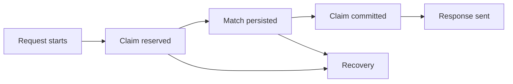

# Worker-crash simulation strategy

## Goal

Verify that a MatchForge claim cannot create a duplicate match, lose a
participant, or leave a participant permanently unavailable when an invocation
stops at any point in the claim lifecycle.

The test suite must simulate the observable effects of serverless termination,
not a provider-specific process implementation. Hosted platforms may freeze,
evict, reset, or replace execution environments, and none guarantees that
application cleanup will run.

## Lifecycle cut points



Inject termination at each boundary:

| Cut point                        | Simulated failure                             | Required invariant                                                       |
| -------------------------------- | --------------------------------------------- | ------------------------------------------------------------------------ |
| Before claim                     | Request fails before Redis claim              | Both participants remain eligible                                        |
| After claim, before persistence  | Worker reset or timeout                       | Claim expires or rolls back; both participants are requeued              |
| After persistence, before commit | Durable write succeeds, invocation disappears | Reconciliation commits the existing match; participants are not requeued |
| During commit                    | One state transition is interrupted           | Commit is atomic or retryable without partial matching                   |
| After commit, before response    | Client disconnect or response failure         | Match remains committed and a retry returns the same match               |
| During rollback                  | Persistence fails and cleanup is interrupted  | Recovery eventually restores only valid participant versions             |
| During sweeper execution         | Sweeper is terminated                         | A later sweeper can safely resume; no duplicate match is created         |

## Failure injector

Production code should expose test-only hooks at durable boundaries, not
provider-specific process controls:

```ts
import { z } from "zod";

const FailurePointSchema = z.enum([
  "before-claim",
  "after-claim",
  "after-persistence",
  "during-commit",
  "after-commit",
  "during-rollback",
  "during-recovery",
]);

const FailureInjectorSchema = z.object({
  hit: z.function({
    input: [FailurePointSchema],
    output: z.promise(z.void()),
  }),
});
```

The default injector is a no-op. Tests use an injector that throws a controlled
termination error once at a selected point. The caller must be discarded after
the error, and recovery must run through a fresh `Matcher` and a fresh
coordination-store instance.

## Test environments

### Deterministic in-memory tests

Use the in-memory adapter to verify state-machine invariants quickly:

- fake clock;
- controlled IDs;
- injected persistence failures;
- injected failures at every lifecycle point;
- repeated recovery calls;
- concurrent claim attempts.

These tests validate the protocol but not distributed behavior.

### Real Redis tests

Use a unique namespace in a non-production Upstash or Redis database:

- create participants and queues;
- run one worker until a selected failure point;
- discard that worker instance;
- create a new worker instance;
- run reconciliation and retry;
- assert queue membership, participant versions, claim state, and durable match
  identity;
- delete every test key in `finally`.

Never simulate a crash by deleting all Redis keys. That tests data loss, not
worker termination.

### Deployment smoke tests

For Vercel, use a short function duration and an endpoint that deliberately
waits at each failure point. Verify that the next request can reconcile the
claim.

For Cloudflare Workers, test client disconnects and `waitUntil()` expiration.
Use a separate Redis-backed test namespace because isolate eviction cannot be
forced reliably from application code.

For Lambda-like testing, run the handler with a timeout and a fresh environment
after a controlled failure. A local process kill can approximate an abrupt reset,
but it is only a harness and not proof of provider behavior.

## Assertions

Every crash test should assert:

- at most one committed match contains either participant;
- a committed durable match is never requeued;
- a reserved claim eventually becomes committed, expired, or rolled back;
- expiry and rollback compare participant versions;
- retries with the same idempotency key return the original outcome;
- retries with a different request are rejected or use a new idempotency key;
- recovery is safe to run repeatedly;
- no test keys remain after teardown.

## Non-goals

- Proving the exact internal shutdown implementation of a provider.
- Treating module-level memory as durable state.
- Relying on `SIGKILL`, `process.exit()`, or an HTTP client disconnect as the
  only crash test.
- Testing transport delivery and matchmaking recovery in the same assertion.
